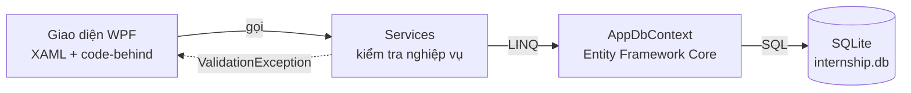

# Hệ thống quản lý thực tập sinh

Bài tập lớn học phần Công nghệ .NET (CSE703009), Đại học Phenikaa.
Ứng dụng desktop WPF xây dựng trên .NET Framework 4.7.2, lưu trữ cơ sở dữ liệu SQLite và truy cập qua Entity Framework Core.

## 1. Chạy chương trình

Yêu cầu môi trường: Windows 10 trở lên, Visual Studio 2022 cài đặt workload .NET desktop development. Lần biên dịch đầu tiên cần kết nối mạng để tải các gói NuGet.

1. Mở file `InternManagement.sln` bằng Visual Studio.
2. Nhấp chuột phải vào project `InternManagement.Wpf`, chọn Set as Startup Project.
3. Nhấn F5. Lần đầu khởi chạy, ứng dụng tự động tạo file cơ sở dữ liệu `internship.db` nằm cùng thư mục file thực thi và nạp dữ liệu mẫu.

Nếu cần đặt lại dữ liệu mẫu về trạng thái ban đầu, xóa file `internship.db` trong thư mục `src/InternManagement.Wpf/bin/Debug/net472/` rồi khởi động lại chương trình.

### Tài khoản mẫu

| Vai trò | Tên đăng nhập | Mật khẩu |
|---|---|---|
| Quản trị viên | `admin` | `admin123` |
| Mentor | `an@congty.vn`, `binh@congty.vn`, `cuong@congty.vn` | `123456` |
| Thực tập sinh | `TTS001` … `TTS006` | `123456` |

Khi thêm mới mentor hoặc thực tập sinh, hệ thống tự động khởi tạo tài khoản tương ứng: tên đăng nhập của mentor là email, của thực tập sinh là mã số TTS, mật khẩu mặc định là 123456.

## 2. Chức năng theo vai trò

| Chức năng | Admin | Mentor | Thực tập sinh |
|---|:-:|:-:|:-:|
| Tổng quan (Dashboard, biểu đồ) | x | | |
| Sơ đồ tổ chức (TreeView) | x | | |
| Quản lý phòng ban | x | | |
| Quản lý mentor | x | | |
| Quản lý thực tập sinh, lọc, xuất CSV | x | Xem TTS của mình | |
| Giao việc | x | TTS của mình | |
| Đánh giá | Xem | TTS của mình | |
| Xem việc được giao, cập nhật tiến độ, xem đánh giá | | | x |
| Đổi mật khẩu, đăng xuất | x | x | x |

### Quy tắc nghiệp vụ

- Mã TTS, email thực tập sinh, email mentor, tên phòng ban và tên đăng nhập không được trùng lặp.
- Email phải đúng cấu trúc chuẩn; số điện thoại nếu cung cấp phải đủ 10 chữ số và bắt đầu bằng số 0.
- Ngày kết thúc thực tập phải sau ngày bắt đầu; thời hạn công việc không được trước ngày giao việc.
- Mentor hướng dẫn phải thuộc cùng phòng ban với thực tập sinh.
- Không cho phép xóa phòng ban còn mentor hoặc thực tập sinh; không cho phép xóa mentor đang hướng dẫn hoặc đã có phiếu đánh giá.
- Xóa hồ sơ thực tập sinh sẽ xóa cascade toàn bộ công việc, phiếu đánh giá và tài khoản đăng nhập tương ứng.
- Chỉ mentor đang trực tiếp hướng dẫn mới được tạo hoặc sửa phiếu đánh giá cho thực tập sinh đó; điểm thành phần giới hạn từ 0 đến 10.
- Thực tập sinh chỉ được quyền cập nhật trạng thái các công việc được giao cho chính mình.
- Công việc quá hạn là công việc chưa hoàn thành có hạn kết thúc trước ngày hiện tại (hiển thị nền đỏ trên danh sách).
- Phân loại kết quả đánh giá theo điểm trung bình: từ 8.5 là Giỏi, từ 7.0 là Khá, từ 5.0 là Trung bình, dưới 5.0 là Yếu.
- Mật khẩu được băm qua thuật toán PBKDF2 với salt ngẫu nhiên, cơ sở dữ liệu không lưu trữ mật khẩu gốc.

## 3. Kiến trúc

```
InternManagement.sln
├── src/InternManagement.Core/        Thư viện nghiệp vụ (netstandard2.0)
│   ├── Models/        Lớp dữ liệu: Person (lớp cha) kế thừa Mentor, Intern; Department, User, TaskItem, Evaluation
│   ├── Data/          AppDbContext (EF Core + SQLite), DbSeeder (tạo CSDL + dữ liệu mẫu)
│   ├── Services/      Nghiệp vụ: Auth, Department, Mentor, Intern, Task, Evaluation, Dashboard
│   ├── Helpers/       PasswordHasher, Validator, CsvExporter, StatusText
│   └── Exceptions/    ValidationException (lỗi nhập liệu / nghiệp vụ)
├── src/InternManagement.Wpf/         Ứng dụng WPF (.NET Framework 4.7.2)
│   ├── App.xaml       Tài nguyên dùng chung: màu, Style, Trigger, Converter
│   ├── LoginWindow    Đăng nhập
│   ├── MainWindow     Menu, ToolBar, StatusBar, chuyển đổi màn hình theo vai trò
│   ├── Views/         Các trang chức năng (UserControl) và cửa sổ nhập liệu (Window)
│   ├── AppServices.cs Khởi tạo CSDL và các service
│   └── Session.cs     Tài khoản đang đăng nhập
└── tests/InternManagement.Core.Tests/ Kiểm thử tự động cho tầng Core (xUnit)
```



Luồng xử lý một thao tác (ví dụ thêm thực tập sinh):
1. `InternEditWindow` gán `DataContext` bằng đối tượng `Intern`; các ô nhập dữ liệu liên kết hai chiều với các thuộc tính của đối tượng.
2. Khi người dùng bấm Lưu, cửa sổ gọi phương thức `AppServices.Interns.Add(intern)`.
3. `InternService` kiểm tra hợp lệ qua `Validator`, xác thực trùng mã, email và kiểm tra tính nhất quán phòng ban của mentor. Nếu vi phạm, service ném `ValidationException` để giao diện bắt lỗi và hiển thị thông báo.
4. Khi dữ liệu đạt yêu cầu, service lưu đối tượng `Intern` và bản ghi `User` tương ứng vào `AppDbContext`, gọi `SaveChanges()` để thực thi câu lệnh SQL INSERT.
5. Cửa sổ đóng lại với `DialogResult = true`, danh sách ở màn hình chính tải lại dữ liệu mới qua `LoadData()`.

### Lựa chọn EF Core 3.1

Đề cương môn học quy định sử dụng .NET Framework, SQLite và Entity Framework. EF6 không hỗ trợ cơ chế tự động sinh bảng trên SQLite lúc khởi chạy. EF Core 3.1 là phiên bản cuối cùng tương thích với .NET Framework 4.7.2 có khả năng tạo bảng tự động qua phương thức `EnsureCreated()`.

### Tách project Core

Tách riêng thư viện nghiệp vụ giúp tầng Service hoàn toàn độc lập với các thư viện giao diện WPF. Cấu trúc này cho phép viết các bài kiểm thử tự động xUnit trong `tests/` và giữ nguyên toàn bộ nghiệp vụ nếu cần thay thế giao diện khác.

## 4. Đối chiếu đề cương học phần

| Nội dung đề cương | Thể hiện trong đồ án |
|---|---|
| 2.8–2.9 Phương thức, lớp | `Models/*`, `Services/*` |
| 2.10 Kế thừa, đa hình | `Person` trừu tượng; các lớp con `Mentor`, `Intern`; thuộc tính `RoleName`, phương thức ảo `GetDisplayInfo()` được `Intern` ghi đè để hiển thị ở Sơ đồ tổ chức |
| 2.11 Tệp (File I/O) | `CsvExporter` xuất dữ liệu danh sách sang định dạng CSV |
| 3.2–3.5 XAML, bố cục | Sử dụng Grid, StackPanel, DockPanel, WrapPanel, Canvas trong các màn hình |
| 3.6 Điều khiển cơ bản | TextBox, PasswordBox, Button, ComboBox, DatePicker, Slider, CheckBox, ProgressBar |
| 3.8 Dữ liệu | DataGrid hiển thị danh sách từ cơ sở dữ liệu |
| 3.11 Menu, ToolBar | Triển khai trong `MainWindow.xaml` |
| 3.12 MessageBox | Hộp thoại thông báo lỗi, xác nhận xóa dữ liệu, thông báo thao tác thành công |
| 3.13 Đồ họa 2D | `DashboardView` vẽ biểu đồ cột bằng hình chữ nhật trên Canvas |
| 4.1 Databinding | Ràng buộc dữ liệu hai chiều ở form nhập liệu, ràng buộc cột trên DataGrid và `SelectedValue` của ComboBox |
| 4.2 Trigger | Đổi viền ô nhập khi focus qua Trigger, đổi màu dòng quá hạn và xếp loại qua DataTrigger |
| 4.3 Resources | Định nghĩa bảng màu, Style nút bấm và Converter dùng chung trong `App.xaml` |
| 4.4 TreeView | `OrgTreeView` biểu diễn phân cấp phòng ban, mentor và thực tập sinh |
| 5.1–5.10 Ứng dụng quản lý | Đăng nhập, phân quyền màn hình, Thêm, Sửa, Xóa, lọc dữ liệu trên SQLite |

## 5. Phân công nhóm

| Thành viên | Phụ trách | File chính |
|---|---|---|
| TV1 | CSDL, Models, đăng nhập, phân quyền, màn hình chính, phòng ban, đổi mật khẩu, tài nguyên giao diện | `Core/Models`, `Core/Data`, `AuthService`, `DepartmentService`, `App.xaml`, `LoginWindow`, `MainWindow`, `DepartmentsView`, `ChangePasswordWindow` |
| TV2 | Quản lý mentor, thực tập sinh, bộ lọc, xuất CSV, sơ đồ tổ chức | `MentorService`, `InternService`, `CsvExporter`, `MentorsView`, `InternsView`, `InternEditWindow`, `OrgTreeView` |
| TV3 | Giao việc, đánh giá, chức năng cho thực tập sinh, Dashboard thống kê | `TaskService`, `EvaluationService`, `DashboardService`, `TasksView`, `EvaluationsView`, `MyTasksView`, `DashboardView` |

Mỗi thành viên cần nắm rõ luồng xử lý phần mình phụ trách để trả lời các câu hỏi bảo vệ ở mục 7.

## 6. Kiểm thử

```
dotnet test
```

Bộ kiểm thử gồm 32 ca kiểm thử tự động cho tầng Core, bao gồm xác thực, đổi mật khẩu, kiểm tra ràng buộc dữ liệu, phân quyền cập nhật công việc, tính điểm đánh giá và trích xuất CSV. Toàn bộ kịch bản chạy trên cơ sở dữ liệu SQLite trong bộ nhớ.

## 7. Câu hỏi thường gặp khi bảo vệ

### Binding hai chiều hoạt động thế nào?
Cửa sổ nhập liệu gán `DataContext = intern`. Các trường nhập liệu có liên kết mặc định TwoWay với thuộc tính đối tượng. Khi người dùng nhập văn bản, giá trị mới tự động gán ngược lại thuộc tính của đối tượng. Khi nhấn nút Lưu, đối tượng đã cập nhật đầy đủ dữ liệu mới và chuyển sang tầng service xử lý.

### Trigger khác DataTrigger thế nào?
Trigger theo dõi trực tiếp các thuộc tính của điều khiển giao diện, ví dụ trạng thái `IsKeyboardFocused` của TextBox. DataTrigger theo dõi giá trị dữ liệu từ đối tượng được binding, ví dụ thuộc tính `IsOverdue` hoặc `Status` của công việc để đổi màu dòng dữ liệu.

### Tính đa hình thể hiện ở đâu?
Lớp trừu tượng `Person` khai báo phương thức ảo `GetDisplayInfo()`. Lớp con `Intern` ghi đè phương thức này để bổ sung mã số thực tập sinh vào chuỗi thông tin. Tại màn hình Sơ đồ tổ chức, chương trình gọi `person.GetDisplayInfo()` trên đối tượng khai báo kiểu `Person`, hệ thống tự động điều phối gọi phương thức của `Mentor` hoặc `Intern` tại thời điểm chạy.

### Vì sao mỗi thao tác lại khởi tạo một AppDbContext mới?
DbContext được thiết kế cho các đơn vị công việc ngắn hạn: tạo trong khối `using`, thực thi truy vấn hoặc cập nhật, gọi `SaveChanges()` rồi hủy kết nối. Cách tiếp cận này tránh giữ bộ nhớ cache thực thể quá lâu và hạn chế xung đột trạng thái giữa các thao tác.

### Mật khẩu được mã hóa và lưu trữ thế nào?
Hệ thống không lưu trữ mật khẩu gốc. `PasswordHasher` sinh salt ngẫu nhiên 16 byte, băm mật khẩu qua PBKDF2 với 10.000 vòng lặp và lưu trữ dưới dạng chuỗi gồm số vòng lặp, salt và giá trị hash. Khi người dùng đăng nhập, mật khẩu nhập vào được băm lại với cùng thông số salt rồi đối soát từng byte theo thời gian cố định nhằm tránh tấn công dò thời gian.

### Vì sao kiểm tra dữ liệu ở tầng Service thay vì trên giao diện?
Đặt toàn bộ logic xác thực tại tầng Service bảo đảm mọi nguồn gọi (nhiều màn hình giao diện khác nhau hoặc các bài kiểm thử tự động) đều phải tuân theo cùng một tập ràng buộc nghiệp vụ. Giao diện người dùng chỉ đảm nhận việc nhập liệu và phản hồi thông báo lỗi.

### Cơ chế phân quyền tài khoản hoạt động thế nào?
Thuộc tính `Role` xác định danh mục menu hiển thị tại `MainWindow` và giới hạn phạm vi truy vấn dữ liệu (mentor chỉ xem danh sách thực tập sinh do mình phụ trách). Các quy tắc bảo mật quan trọng như chỉ mentor hướng dẫn mới được chấm điểm đều được kiểm tra chặt chẽ tại tầng Service.

### Cơ chế vẽ lại biểu đồ khi thay đổi kích thước cửa sổ?
Biểu đồ cột được dựng từ các hình chữ nhật trên Canvas với tọa độ tính theo thuộc tính `ActualWidth`. Khi kích thước cửa sổ thay đổi, sự kiện `SizeChanged` kích hoạt hàm tính toán lại tỷ lệ và vẽ lại biểu đồ phù hợp với không gian mới.
